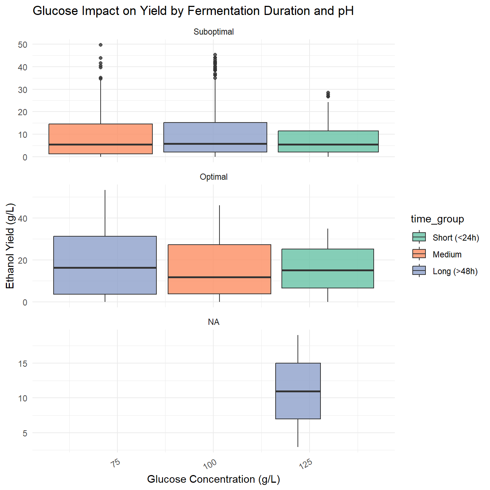
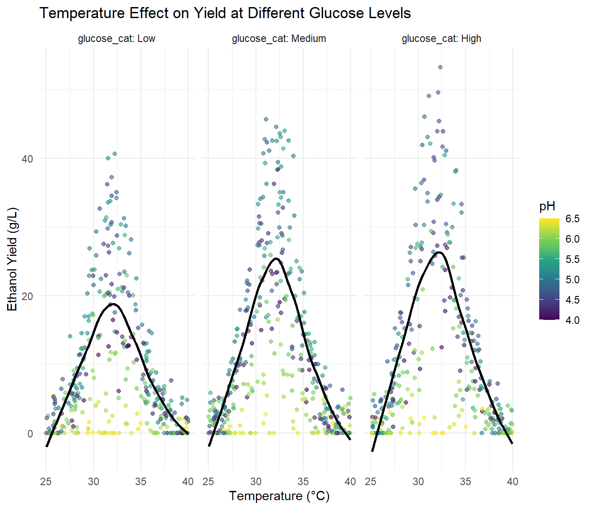
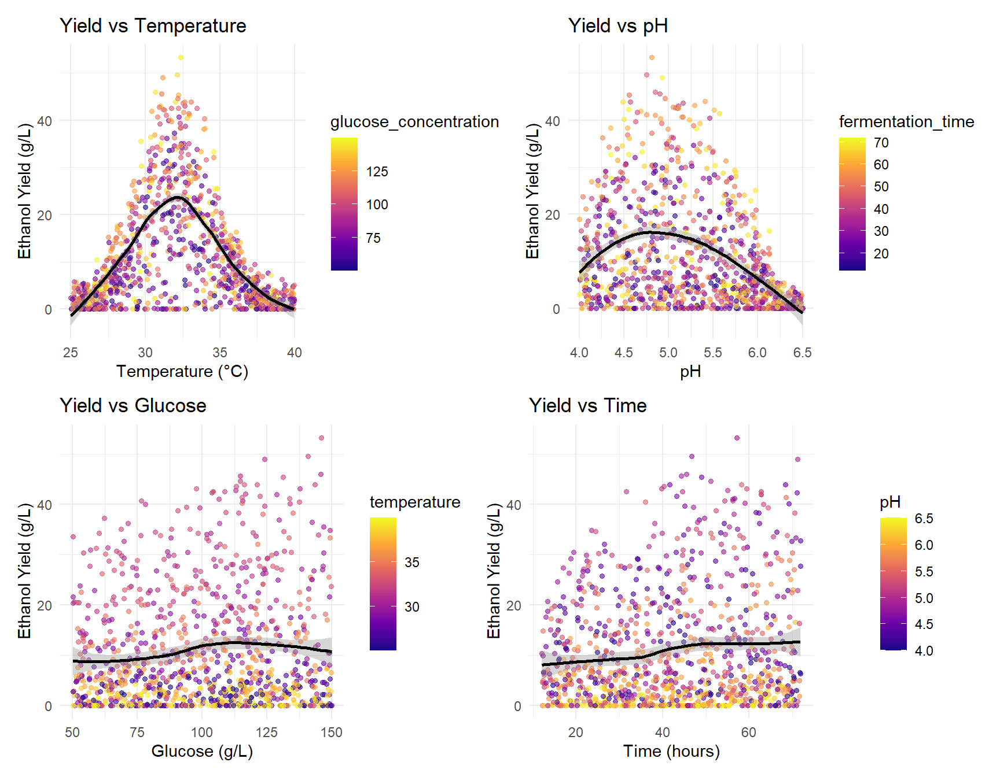
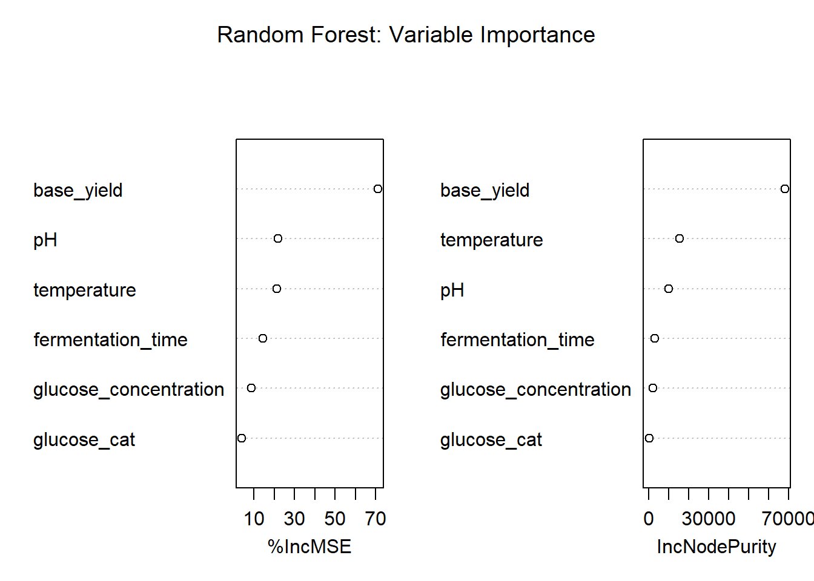
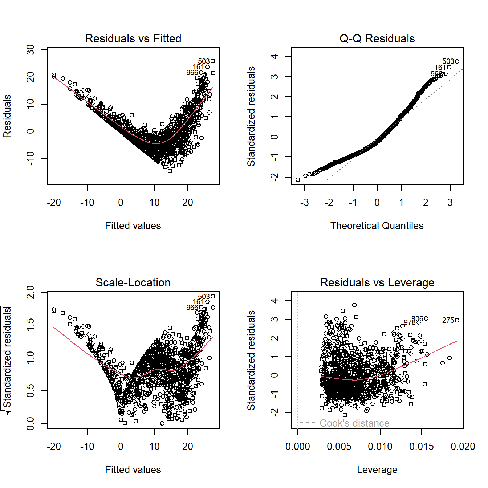

# HABB447 Industrial Biotech Project

R-based bioprocess simulation and fermentation analysis for HABB447 Industrial Biotechnology. This project models process behaviour, visualises key fermentation variables, and summarises the performance of the simulated bioprocess workflow in an interactive report.

## Full rendered report

- [Open the knitted HTML report](knit.html)
- [Open the Quarto report](bioprocess_simulation.html)

## Project overview

This work explores simulated fermentation dynamics using a realistic production dataset. The report highlights changes in glucose, pH, temperature, and process relationships to show how the bioprocess behaves over time and how key variables interact.

### Fermentation dynamics

### Temperature and process relationships

### Variable relationships

### Model diagnostics

### Process diagnostics

## Included files

- `app.R` — interactive Shiny application
- `bioengineering_pipeline.R` — analysis workflow
- `simulated_fermentation_data.csv` — simulated fermentation dataset
- `knit.Rmd` and `bioprocess_simulation.qmd` — report source files

## Run locally

Open the project in RStudio, load the data, and run the scripts or render the report as needed.
